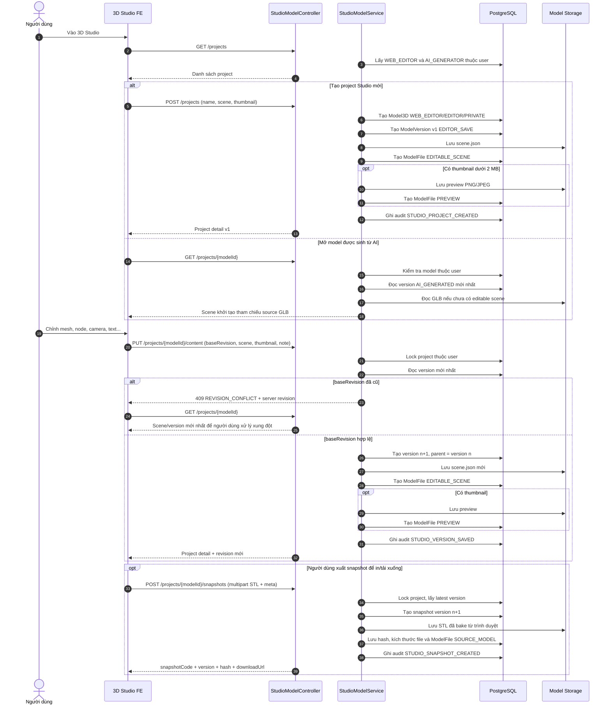
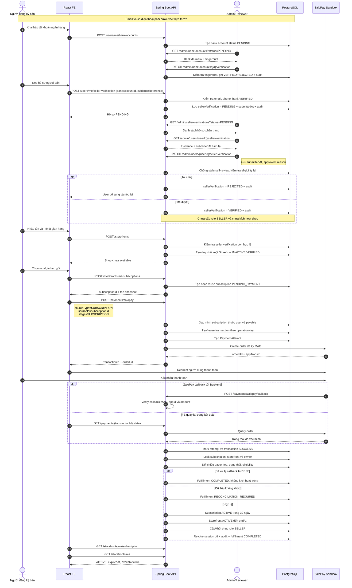

# Sequence diagram — các luồng Backend đã tương đối hoàn thiện

Tài liệu này được dựng từ code hiện tại của `3DWorld-SWD-BE`, không suy diễn từ mock UI.

Phạm vi gồm:

1. AI Studio sinh mô hình 3D.
2. 3D Studio tạo, chỉnh sửa, lưu phiên bản và xuất snapshot.
3. Đăng ký người bán, tạo gian hàng và mua gói thuê gian hàng.

Luồng shipment/GHTK chưa hoàn thiện được **chủ động loại khỏi tài liệu này**.

## 1. Đánh giá nhanh mức độ hoàn thiện

| Luồng | Mức độ hiện tại | Nhận xét |
|---|---|---|
| 3D Studio | Hoàn thiện nhất và tự chứa nhất | Có ownership, tạo project, version tree, chống ghi đè bằng revision, scene storage, thumbnail, snapshot, download và audit log. Ít phụ thuộc dịch vụ ngoài. |
| Đăng ký gian hàng + mua gói | Hoàn thiện về nghiệp vụ Backend | Có điều kiện xác minh, Admin review, payment idempotency, xác minh ZaloPay, kích hoạt 30 ngày và cấp role `SELLER`. Cần cấu hình callback công khai hoặc FE chủ động query payment status. |
| AI generation | Hoàn thiện happy path, còn điểm cần gia cố production | Có estimate, trừ/refund credit, Meshy, polling/webhook, lưu model/version/file và audit. Upload ảnh trung gian hiện còn nằm trong memory; webhook chỉ hoạt động khi cấu hình secret; progress chưa phản ánh đầy đủ phần trăm từ provider. |

Nếu chọn một luồng để trình bày là “hoàn thiện nhất”, nên chọn **3D Studio: tạo project → chỉnh sửa → lưu version → tạo snapshot**. Nếu cần một luồng nghiệp vụ có nhiều actor nhất để bảo vệ đồ án, chọn **đăng ký gian hàng → duyệt seller → thanh toán gói → kích hoạt shop**.

---

## 2. AI Studio — sinh mô hình 3D

### API chính

| Mục đích | API |
|---|---|
| Lấy cấu hình model/preset | `GET /api/ai-studio/config-options` |
| Ước tính credit | `POST /api/ai-studio/estimates` |
| Upload ảnh nguồn | `POST /api/ai-studio/uploads` |
| Tạo task thống nhất | `POST /api/ai-studio/tasks` |
| Đồng bộ trạng thái Meshy | `POST /api/ai-studio/tasks/{requestId}/refresh` |
| Xem task | `GET /api/ai-studio/tasks/{requestId}` |
| Hủy task | `POST /api/ai-studio/tasks/{requestId}/cancel` |
| Xem project/version | `GET /api/ai-studio/projects/{modelId}`, `GET /api/ai-studio/versions/{versionId}` |
| Export/download | `POST /api/ai-studio/versions/{versionId}/exports`, `GET /api/ai-studio/assets/{fileId}/file` |

`/api/ai/*` và `/api/ai-studio/*` đang là hai base path tương đương. FE nên thống nhất dùng một base path; hiện giao diện đang phù hợp với `/api/ai-studio`.

### Sequence diagram

```mermaid
sequenceDiagram
    autonumber
    actor User as Người dùng
    participant FE as React FE
    participant API as AiGenerationController
    participant AI as AiTaskService
    participant DB as PostgreSQL
    participant Meshy as Meshy API
    participant Storage as Model Storage

    User->>FE: Chọn Text-to-3D hoặc Image-to-3D
    FE->>API: GET /config-options
    API-->>FE: Model, preset, giới hạn ảnh
    FE->>API: POST /estimates
    API->>DB: Đọc số dư AI credit
    API-->>FE: quotedCredits + đủ/thiếu credit

    alt Image-to-3D
        FE->>API: POST /uploads (multipart image)
        API->>AI: Kiểm tra MIME, dung lượng, kích thước
        AI-->>FE: uploadId
        FE->>API: POST /tasks (uploadIds, consent, quotedCredits, config)
        AI->>AI: Kiểm tra upload thuộc user và giá không đổi
    else Text-to-3D
        FE->>API: POST /tasks (name, prompt, config)
        AI->>AI: Chuẩn hóa prompt và config
    end

    AI->>DB: Lock user, kiểm tra active và trừ credit
    AI->>DB: Tạo Model3D PRIVATE
    AI->>DB: Tạo AiRequest status PENDING
    Note over AI,DB: Transaction DB ngắn, kết thúc trước khi gọi provider

    AI->>Meshy: Submit text/image generation
    alt Provider nhận task
        Meshy-->>AI: providerJobId
        AI->>DB: AiRequest = PROCESSING
        AI-->>FE: requestId, modelId, PROCESSING
    else Provider từ chối rõ ràng
        Meshy-->>AI: 4xx không retry
        AI->>DB: AiRequest = FAILED
        AI->>DB: Hoàn credit đúng một lần + audit
        AI-->>FE: FAILED + failureReason
    else Timeout/mất kết nối, chưa biết kết quả
        AI->>DB: Giữ task chờ reconciliation
        AI-->>FE: PROCESSING + cảnh báo timeout
    end

    loop Poll đến khi kết thúc
        FE->>API: POST /tasks/{requestId}/refresh
        API->>AI: Lock task thuộc user
        AI->>Meshy: GET provider task
        alt Meshy vẫn xử lý
            Meshy-->>AI: PENDING/IN_PROGRESS
            AI-->>FE: PROCESSING
        else Meshy thất bại hoặc bị hủy
            Meshy-->>AI: FAILED/CANCELED
            AI->>DB: Mark FAILED
            AI->>DB: Refund credit một lần + audit
            AI-->>FE: FAILED
        else Meshy hoàn thành
            Meshy-->>AI: SUCCESS + GLB/asset URLs
            AI->>Meshy: Download GLB và các format có sẵn
            AI->>DB: Kiểm tra ai_request chưa có version
            AI->>DB: Tạo ModelVersion source AI_GENERATED
            AI->>Storage: Lưu GLB và asset bổ sung
            AI->>DB: Tạo ModelFile, mark request SUCCESS, audit
            AI-->>FE: SUCCESS + version + file metadata
        end
    end

    opt Webhook được cấu hình secret
        Meshy->>API: POST /api/webhooks/meshy
        API->>AI: Tìm task theo providerJobId
        AI->>Meshy: Refresh trạng thái
        Note over API,AI: Webhook bổ trợ; polling vẫn là đường an toàn hiện tại
    end
```

### Trạng thái dữ liệu

```text
AiRequest: PENDING → PROCESSING → SUCCESS
                              ↘ FAILED

SUCCESS tạo:
Model3D → ModelVersion(AI_GENERATED) → ModelFile(GLB/asset)
```

### Điểm cần lưu ý

- `completeGeneration()` có kiểm tra `ai_request_id` đã sinh version hay chưa, giúp callback/poll lặp không tạo version trùng.
- Credit được refund theo cơ chế “consume once”, tránh hoàn hai lần.
- Với lỗi mạng không xác định, Backend không tự refund ngay vì provider có thể đã nhận job.
- Text-to-3D hiện ổn định hơn Image-to-3D vì image unified flow phụ thuộc staged upload trong memory.
- FE không nên chỉ gọi `GET /tasks/{id}` để chờ kết quả; cần gọi endpoint `/refresh` hoặc dựa vào webhook đã cấu hình.

---

## 3. 3D Studio — project, version và snapshot

### API chính

| Mục đích | API |
|---|---|
| Danh sách project | `GET /api/studio/projects` |
| Tạo project | `POST /api/studio/projects` |
| Mở project | `GET /api/studio/projects/{modelId}` |
| Lưu scene có chống xung đột | `PUT /api/studio/projects/{modelId}/content` |
| Lưu version tương thích cũ | `POST /api/studio/projects/{modelId}/save` |
| Cập nhật metadata | `PATCH /api/studio/projects/{modelId}` |
| Nhân bản/xóa mềm | `POST /api/studio/projects/{modelId}/duplicate`, `DELETE /api/studio/projects/{modelId}` |
| Tạo snapshot JSON/STL | `POST /api/studio/projects/{modelId}/snapshots` |
| Xem version/snapshot | `GET /api/studio/projects/{modelId}/versions`, `GET /api/studio/projects/{modelId}/snapshots` |
| Download file | `GET /api/studio/projects/{modelId}/files/{fileId}/download` |

### Sequence diagram



### Vì sao đây là luồng hoàn thiện nhất?

- Ownership được kiểm tra ở mọi thao tác đọc/ghi/download.
- Mỗi lần lưu tạo version bất biến mới, có `parentVersionId`.
- Có optimistic concurrency bằng `baseRevision`/`expectedVersion`, trả `409 REVISION_CONFLICT` khi tab cũ ghi đè.
- Dùng chung `Model3D`, `ModelVersion`, `ModelFile` với AI Studio nên model AI có thể mở và tiếp tục chỉnh trong Studio.
- Có snapshot JSON và snapshot STL do browser bake, kèm hash và metadata.
- Có unit/integration test riêng cho create, save, conflict, snapshot và AI → Studio interoperability.

---

## 4. Đăng ký người bán, tạo gian hàng và mua gói

### Điều kiện trước khi nộp hồ sơ

- Tài khoản đang active.
- Email đã xác thực.
- Số điện thoại đã xác thực và chưa thay đổi sau lúc nộp.
- Có tài khoản ngân hàng thuộc chính user, đang active và đã được Admin duyệt `VERIFIED`.

### API chính

| Giai đoạn | API |
|---|---|
| Khai báo ngân hàng | `POST /api/users/me/bank-accounts` |
| Admin duyệt ngân hàng | `PATCH /api/admin/bank-accounts/{id}/verification` |
| Nộp hồ sơ seller | `POST /api/users/me/seller-verification` |
| Admin xem hàng chờ | `GET /api/admin/seller-verifications?status=PENDING` |
| Admin duyệt seller | `PATCH /api/admin/users/{id}/seller-verification` |
| Tạo storefront | `POST /api/storefronts` |
| Tạo/reuse subscription | `POST /api/storefronts/me/subscriptions` |
| Khởi tạo ZaloPay | `POST /api/payments/zalopay` |
| Callback ZaloPay | `POST /api/payments/zalopay/callback` |
| FE kiểm tra lại payment | `GET /api/payments/{transactionId}/status` |
| Xem shop/gói hiện tại | `GET /api/storefronts/me`, `GET /api/storefronts/me/subscription` |

### Sequence diagram



### Trạng thái chính

```text
Seller verification: NOT_SUBMITTED → PENDING → VERIFIED | REJECTED
Bank verification:   PENDING → VERIFIED | REJECTED
Storefront:          INACTIVE → ACTIVE
Subscription:        PENDING_PAYMENT → ACTIVE
Payment:             PENDING → SUCCESS | FAILED
Fulfillment:         PENDING → COMPLETED | RECONCILIATION_REQUIRED
```

### Quy tắc quan trọng cho FE

- Duyệt hồ sơ seller **không** tự cấp role `SELLER`.
- Tạo storefront chỉ tạo shop `INACTIVE`; chưa được đăng bán.
- Chỉ callback/query thanh toán đã được Backend xác minh mới kích hoạt shop.
- Sau khi cấp role `SELLER`, Backend revoke session cũ. FE nên gọi lại `/api/auth/me`; nếu token/session cũ bị từ chối thì yêu cầu đăng nhập lại để nhận role mới.
- Hiện chỉ có một mức phí tháng lấy từ platform config, chưa có nhiều loại plan để lựa chọn.
- Gia hạn khi shop còn hạn sẽ cộng thêm 30 ngày từ `expiresAt`; shop hết hạn sẽ tính 30 ngày từ thời điểm thanh toán.

---

## 5. Các thành phần Backend làm nguồn đối chiếu

- AI: `AiGenerationController`, `AiTaskServiceImpl`, `MeshyAdapter`, `AiWalletServiceImpl`.
- Studio: `StudioModelController`, `StudioModelServiceImpl`.
- Seller verification: `SellerVerificationController`, `SellerVerificationService`, `BankVerificationService`.
- Storefront/subscription: `StorefrontController`, `StorefrontService`.
- Payment: `PaymentController`, `PaymentServiceImpl`, `PaymentSourceResolver`, `OrderPaymentService`.

Không có endpoint shipment nào được đưa vào các diagram phía trên.
